<p align="center">
  
</p>

<p align="center"><strong>Every offcut, on the record.</strong></p>

<p align="center">
  <a href="https://github.com/Rayenbabdallah/revalo/actions/workflows/backend.yml"></a>
  <a href="https://github.com/Rayenbabdallah/revalo/actions/workflows/frontend.yml"></a>
  <a href="https://github.com/Rayenbabdallah/revalo/actions/workflows/docker.yml"></a>
</p>

Revalo turns the files that CNC machines already produce into a verified record
of every leftover piece: its size, weight and value, where it sits on the rack,
and the best thing to do with it. Reuse it in a coming job, sell it to an artisan
nearby, or send it to the recycler who pays the most. Built for small metal and
wood workshops in Tunisia, in English, French and Arabic.

<p align="center">
  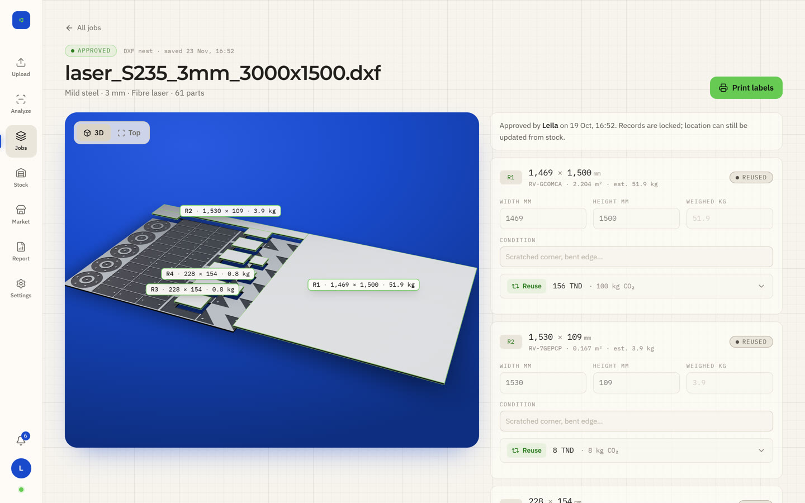
</p>

---

## The problem

Every sheet cut on a laser, plasma table or router leaves material behind:
reusable remnants and a scrap skeleton. In most small workshops these offcuts
pile up in a corner. Nobody records their size, weight or value, so they are
forgotten, sold by eye as scrap, or thrown away, while new sheets keep being
bought for parts that would have fit on them.

## What Revalo does

<p align="center">
  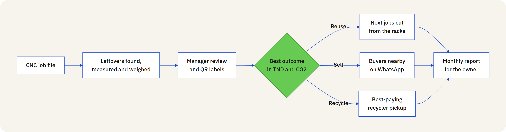
</p>

1. **Upload.** The operator picks the machine and the file it just cut. No
   typing, no measuring tape.
2. **Analyze.** Revalo reads the cut and finds every reusable remnant and the
   scrap skeleton, with exact sizes and weights, shown on the sheet in 3D.
3. **Review and label.** The manager checks each record against the real sheet,
   approves the batch, and prints QR labels. Every change keeps who made it.
4. **Decide.** Each piece is valued three ways, in dinars and CO₂: reuse (new
   material not bought), sell (resale minus commission), recycle (scrap price by
   weight). Revalo recommends one and shows why.
5. **Reuse, sell or recycle.** Coming jobs are checked against the racks before a
   new sheet is opened. Pieces that will not be reused go to buyers matched by
   material, size, price and distance; scrap goes to recyclers as sorted lots.
6. **Report.** One page for the owner each month: what leftovers brought back,
   against the price of Revalo, with kilograms kept out of the bin and CO₂
   avoided.

## Screenshots

<table>
  <tr>
    <td width="50%">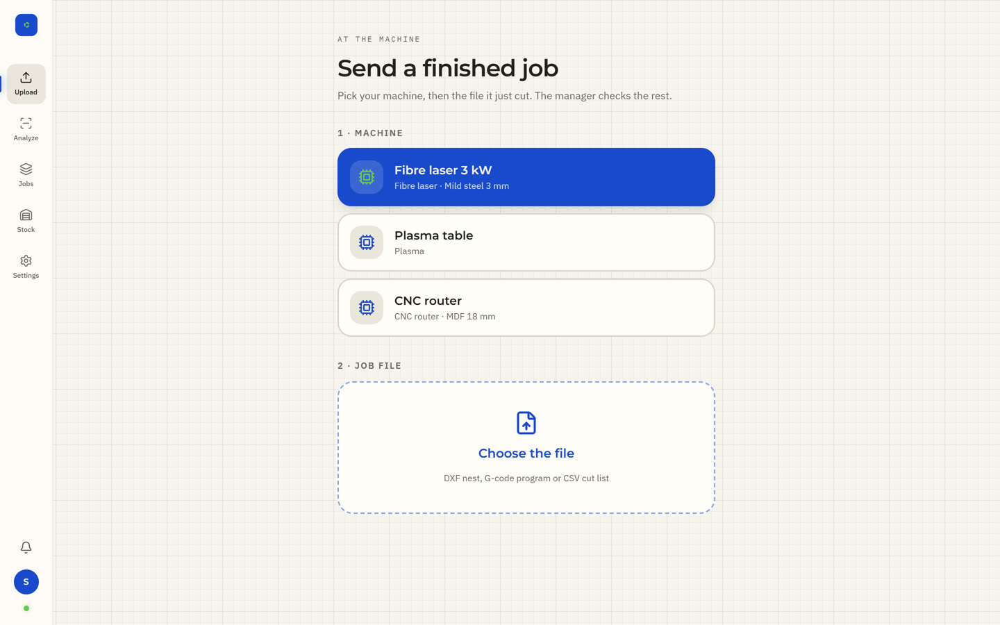<br><sub><b>At the machine.</b> Two taps: the machine preset and the file it just cut.</sub></td>
    <td width="50%">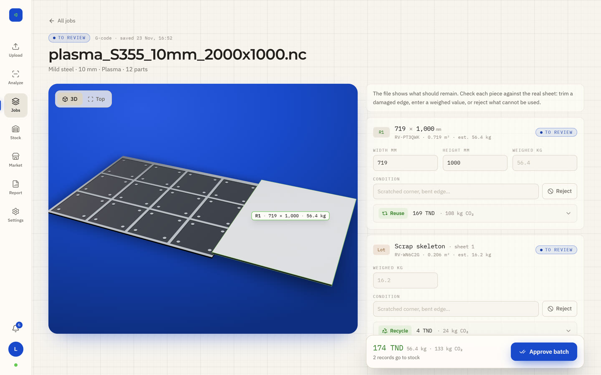<br><sub><b>Review.</b> Trim a damaged edge, enter a weighed value, approve the batch.</sub></td>
  </tr>
  <tr>
    <td>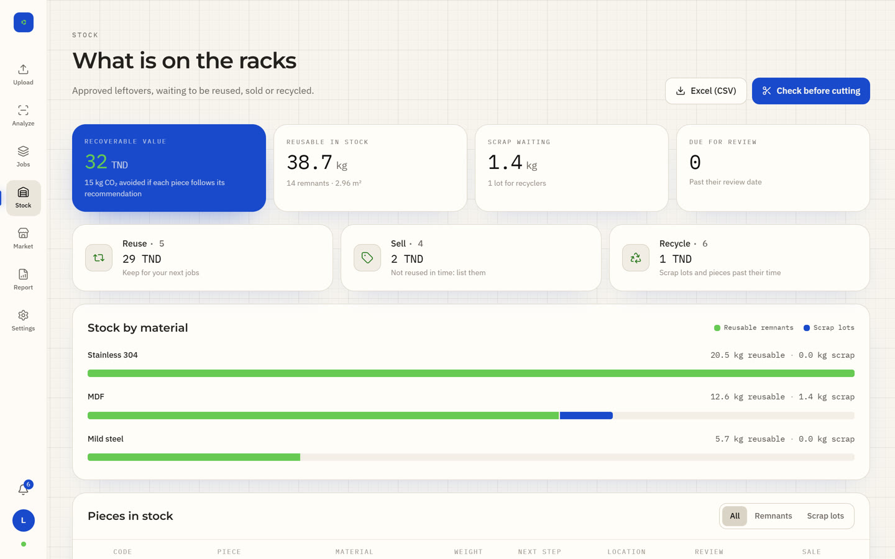<br><sub><b>Stock.</b> What is on the racks, its value, and the next step for each piece.</sub></td>
    <td>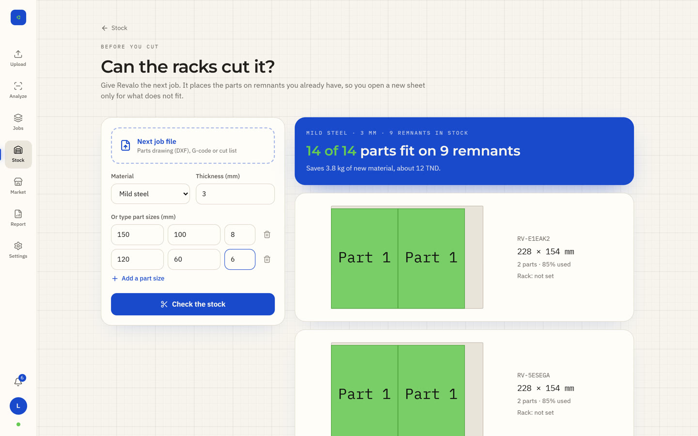<br><sub><b>Before cutting.</b> The next job's parts placed on remnants already in stock.</sub></td>
  </tr>
  <tr>
    <td>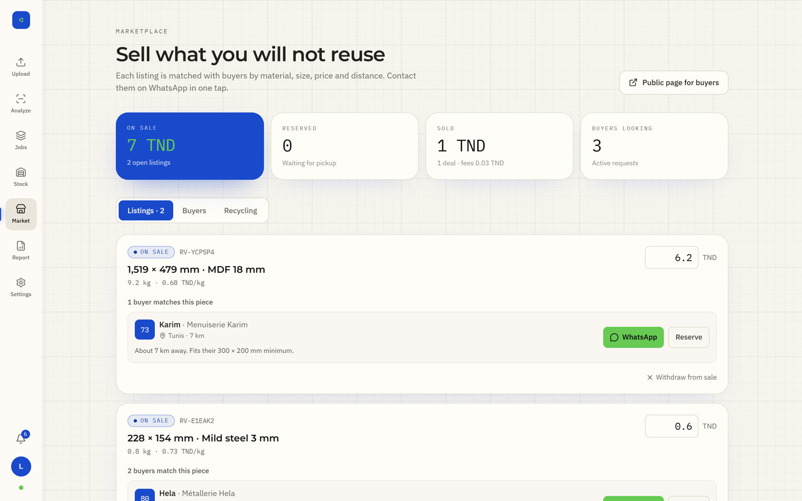<br><sub><b>Marketplace.</b> Listings matched with buyers, contacted on WhatsApp in one tap.</sub></td>
    <td>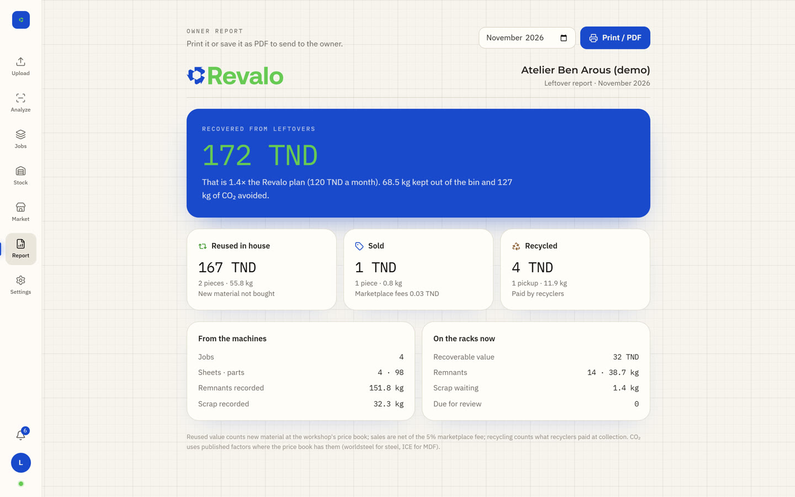<br><sub><b>Owner report.</b> What leftovers brought back this month.</sub></td>
  </tr>
  <tr>
    <td>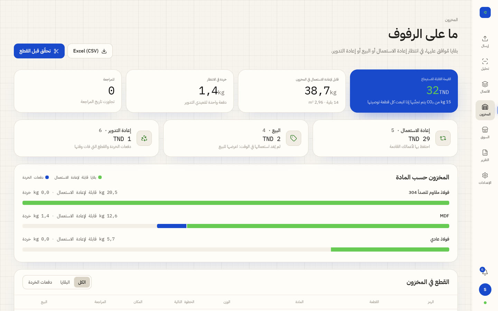<br><sub><b>Arabic, right to left.</b> Also in French and English.</sub></td>
    <td>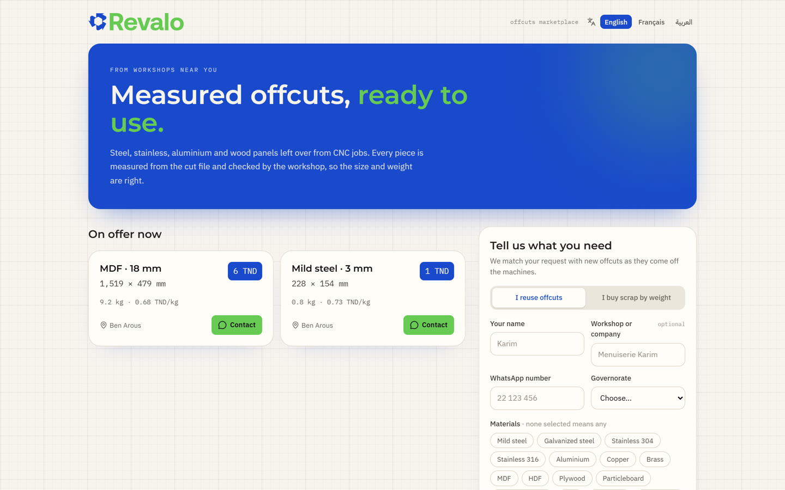<br><sub><b>Buyer page.</b> Measured offcuts on offer, and a form to post a need.</sub></td>
  </tr>
</table>

## Features

**Reading the cut**
- DXF nests, G-code programs (lasers, plasma tables, routers, including LinuxCNC
  macros) and CSV cut lists for panel saws.
- Material, thickness, process and sheet size read from the file when present.
- Repeat runs recognised: a program sent again is never doubled in stock; Revalo
  asks whether it was cut again, and one upload can record several sheets.

**On the racks**
- QR labels on thermal or A4 sticker paper; a scan opens the piece on any phone,
  with one-tap actions: move, take for a job, weigh, scrap, reprint, list.
- Offcuts already on the racks entered by form or CSV, checked for duplicates.
- Weights that learn from the scale: after three weighings of a material, new
  estimates are corrected.
- Remnants exported as DXF sheets for the nesting software.

**Finding a use for every piece**
- Check before cutting: a coming job's parts placed on remnants in stock.
- Planned jobs: every new offcut is checked against coming jobs and waiting
  buyers the moment it is approved.
- Marketplace with a public buyer page, matching by material, thickness, size,
  price and distance between governorates, and ready WhatsApp messages.
- Batch lots: similar offcuts sold as one deal, whole or in part, with a pick
  list sorted by rack.
- Recycler pickups: scrap grouped by material for the best-paying recycler
  nearby, with the weighed ticket recorded.

**For the workshop and its owner**
- Roles for operators, managers and owners; every record keeps the name of who
  made or changed it.
- Alerts for what needs attention now; monthly owner report; Excel export.
- English, French and Arabic (right to left), including text the server writes.

## How the engine works

- **Geometry.** Cut paths are rebuilt into closed contours (blocks, arcs,
  splines, loose segments with small gaps). Holes are found with the even-odd
  rule; the sheet outline is detected or estimated.
- **Remnants.** The free area of each sheet, after parts and kerf, is searched
  on a grid for the largest clean rectangles; a remnant is kept only if its
  shorter side is useful (by default 100 mm for metal, 150 mm for wood). What
  remains is the scrap skeleton.
- **Weights.** Area × thickness × density from a material library with cited
  sources, corrected by what the workshop's scale has shown.
- **Decisions.** Transparent rules, not a black box: each option's value in TND
  and CO₂, with the reasons written out. A remnant is first kept for reuse; after
  its review date it should be sold, after a second period recycled.
- **Matching and fitting.** Buyers are scored on material, thickness, size,
  price and distance across Tunisia's 24 governorates. Coming jobs are packed onto
  stock remnants with guillotine cuts, keeping the best of several strategies.

Defaults are conservative: only rectangular remnants are counted and fits use
straight cuts, so real results are usually a little better than predicted, never
worse. Prices ship only where a source exists (mild steel and MDF); every other
material uses the workshop's own quotes.

## Architecture

<p align="center">
  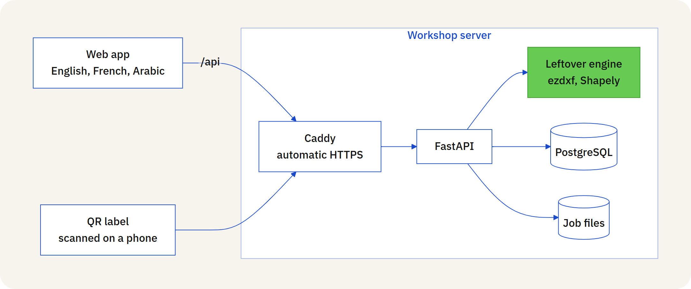
</p>

| Layer | Technology |
|---|---|
| Engine | Python 3.11, ezdxf, Shapely, NumPy |
| API | FastAPI, SQLAlchemy, Alembic, Pydantic |
| Web app | React 19, TypeScript, Vite, Tailwind CSS, Three.js (React Three Fiber), TanStack Query |
| Data | PostgreSQL in production, SQLite for development and tests |
| Delivery | Docker Compose, Caddy with automatic HTTPS, GitHub Actions |

No paid service or cloud API is required. Passwords are hashed with scrypt,
sessions are HttpOnly cookies stored only as hashes, sign-in attempts are
throttled, and every route checks the person's role on the server.

## Quality

- **261 automated tests** covering the importers, geometry, decisions, matching,
  every API route and role, and the database migrations.
- **Continuous integration** on every change: lint and tests, the full migration
  history and demo data on PostgreSQL, the translation check, and a build and
  start of the complete Docker stack.
- **Accuracy check** on any job files: `revalo accuracy` verifies that parts,
  remnants and kerf fit within each sheet, that nothing overlaps or leaves the
  sheet, that minimum sizes and weights hold, and compares results with reviewed
  baselines. All 13 sample files pass, including 8 real open-source CAD and CAM
  files ([samples](samples/README.md)).

## Run it

**With Docker** (PostgreSQL, API and web app behind HTTPS):

```bash
cp .env.example .env          # set POSTGRES_PASSWORD, SITE_ADDRESS and REVALO_PUBLIC_URL
docker compose up -d --build
```

Open the site and create the workshop and its owner on the first screen.

**A demo workshop** with three accounts, machines, jobs, buyers, a sale and a
recycler pickup, on an empty database:

```bash
docker compose exec -e REVALO_DEMO_PASSWORD=choose-a-password api revalo demo
```

**For development** (Python 3.11+ with [uv](https://docs.astral.sh/uv/), Node 22+
with pnpm):

```bash
cd backend && uv sync && uv run uvicorn revalo.api.main:app --reload   # API on :8000, docs at /docs
cd frontend && pnpm install && pnpm dev                                # app on :5173
```

```bash
cd backend
uv run pytest                     # tests
uv run revalo accuracy            # engine accuracy on the samples, or on your own files
uv run revalo analyze ../samples/synthetic/laser_S235_3mm_3000x1500.dxf --svg preview.svg
```

<details>
<summary><b>Configuration</b></summary>

| Variable | Default | Purpose |
|---|---|---|
| `REVALO_DATABASE_URL` | SQLite in `backend/var/` | Database connection |
| `REVALO_STORAGE_DIR` | `backend/var/files` | Where original job files are kept |
| `REVALO_PUBLIC_URL` | `http://localhost:5173` | Address printed in QR labels and messages |
| `REVALO_WORKSHOP_NAME` | `My workshop` | Name of the workshop this deployment serves |
| `REVALO_WORKSHOP_GOVERNORATE` | `Ben Arous` | Workshop location, used for distances to buyers |
| `REVALO_WORKSHOP_PHONE` | none | WhatsApp number buyers reach from the public page |
| `REVALO_REVIEW_DAYS` | `30` | Days in stock before a piece is reviewed |
| `REVALO_PLAN_TND` | `120` | Monthly plan price in the owner report |
| `REVALO_CORS_ORIGINS` | `http://localhost:5173` | Allowed web origins |
| `REVALO_AUTO_MIGRATE` | `1` | Apply migrations when the API starts |
| `REVALO_SECURE_COOKIES` | auto | `1` forces Secure cookies (set automatically behind HTTPS) |
| `REVALO_DEMO_PASSWORD` | none | Password of the demo accounts created by `revalo demo` |

</details>

<details>
<summary><b>Repository layout</b></summary>

```
backend/
  src/revalo/engine/     file importers, leftover geometry, decisions, matching, fitting
  src/revalo/services/   jobs, stock, market, lots, pickups, reports, accounts
  src/revalo/api/        HTTP API
  src/revalo/db/         database models
  migrations/            database migrations
  tests/                 automated tests
frontend/                web app, with brand assets in public/brand
samples/                 sample jobs, their licences and reviewed results
docs/images/             screenshots and diagrams
docs/diagrams/           diagram sources (Mermaid)
compose.yaml             production stack
```

</details>

## Team

Built by **Team Ferran**, IEEE TBS Student Branch, for the IEEE Tunisia SYP 14
AOTN challenge.
